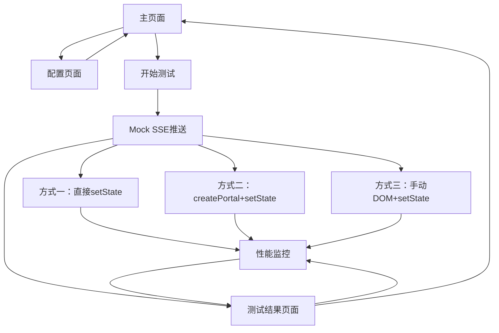

# AI消息对话打字机效果性能评估应用

## 1. Product Overview

一个专门用于评估AI消息对话中打字机效果性能的测试应用，基于Vite和React技术栈开发。

* 主要目的：对比三种不同的打字机效果实现方式在长消息场景下的性能表现，特别关注setState触发的组件重渲染对性能的影响。

* 目标用户：前端开发者、性能优化工程师，用于技术选型和性能优化决策。

## 2. Core Features

### 2.1 Feature Module

我们的性能评估应用包含以下核心页面：

1. **主页面**：性能测试控制台，包含四种实现方式的测试区域和性能监控面板。
2. **测试结果页面**：性能数据对比展示，包含渲染次数、内存使用、CPU占用等指标。
3. **配置页面**：测试参数设置，包含消息长度、打字速度、测试轮数等配置选项。

### 2.2 Page Details

| Page Name | Module Name | Feature description                          |
| --------- | ----------- | -------------------------------------------- |
| 主页面       | 测试控制台       | 提供三个独立的测试区域，每个区域对应一种实现方式，包含开始/停止测试按钮         |
| 主页面       | 方式一测试区      | 使用SSE接收字符并直接setState实现打字机效果，显示实时消息内容         |
| 主页面       | 方式二测试区      | 通过createPortal创建chat组件，使用SSE+setState实现打字机效果 |
| 主页面       | 方式三测试区      | 使用SSE接收字符时手动更新DOM，传输完成后调用整体setState          |
| 主页面       | 方式四测试区      | 使用React.memo+useMemo+时间切片优化，结合虚拟滚动技术实现高性能渲染  |
| 主页面       | 性能监控面板      | 实时显示四种方式的渲染次数、内存使用、执行时间等性能指标                 |
| 主页面       | Mock SSE服务  | 模拟服务端推送，可配置推送速度和消息长度，支持长文本测试                 |
| 测试结果页面    | 性能对比图表      | 以图表形式展示三种方式的性能数据对比，包含柱状图和折线图                 |
| 测试结果页面    | 详细数据表格      | 显示每次测试的详细性能数据，支持导出CSV格式                      |
| 配置页面      | 测试参数设置      | 配置消息长度（字符数）、打字速度（字符/秒）、测试轮数等参数               |
| 配置页面      | 性能监控配置      | 设置性能监控的采样频率和监控指标选择                           |

## 3. Core Process

### 主要测试流程

1. 用户在配置页面设置测试参数（消息长度、打字速度等）
2. 在主页面选择要测试的实现方式（四种方式任选），点击开始测试
3. Mock SSE服务开始推送字符数据
4. 对应的实现方式开始渲染打字机效果
5. 性能监控面板实时收集和显示性能数据
6. 测试完成后跳转到结果页面查看四种方式的性能对比

## 4. User Interface Design

### 4.1 Design Style

* 主色调：#2563eb（蓝色），辅助色：#f3f4f6（浅灰）

* 按钮样式：圆角按钮，hover效果，主要按钮使用渐变色

* 字体：系统默认字体，代码区域使用等宽字体，主要文字14px，标题18px

* 布局风格：卡片式布局，顶部导航，左右分栏显示测试区域和监控面板

* 图标风格：简洁线性图标，使用性能相关的图标如⚡、📊、🔧

### 4.2 Page Design Overview

| Page Name | Module Name | UI Elements                        |
| --------- | ----------- | ---------------------------------- |
| 主页面       | 测试控制台       | 四列布局，每列一个测试区域，底部性能监控面板，使用卡片容器，蓝色主题 |
| 主页面       | 测试区域        | 白色背景卡片，顶部标题，中间消息显示区域，底部控制按钮，实时滚动效果 |
| 主页面       | 性能监控面板      | 深色背景，实时数据更新，使用数字动画效果，图表可视化         |
| 测试结果页面    | 对比图表        | 响应式图表布局，多色柱状图，悬停显示详细数据，导出按钮        |
| 配置页面      | 参数设置        | 表单布局，滑块和输入框组合，实时预览效果，保存/重置按钮       |

### 4.3 Responsiveness

桌面优先设计，支持移动端自适应。在移动端将四列布局改为单列垂直布局，性能监控面板可折叠显示，支持触摸操作优化。

## 5. 技术实现方案详解

### 5.1 四种实现方式对比

**方式一：直接setState**

* 技术原理：每接收到一个字符立即调用setState更新组件状态

* 性能特点：频繁触发组件重渲染，可能导致性能瓶颈

* 适用场景：短消息、低频更新场景

**方式二：createPortal + setState**

* 技术原理：使用React Portal将聊天组件渲染到独立的DOM节点，减少父组件重渲染影响

* 性能特点：隔离渲染上下文，但仍存在频繁setState问题

* 适用场景：需要独立渲染上下文的复杂UI场景

**方式三：手动DOM操作**

* 技术原理：SSE接收过程中直接操作DOM元素，完成后一次性setState

* 性能特点：避免频繁重渲染，但绕过了React的优化机制

* 适用场景：对性能要求极高的场景

**方式四：React优化 + 时间切片（业界最佳实践）**

* 技术原理：

  * 使用React.memo包装组件避免不必要的重渲染

  * 使用useMemo缓存计算结果

  * 使用useCallback缓存事件处理函数

  * 实现时间切片，将长文本分批渲染

  * 结合虚拟滚动技术处理大量消息

* 性能特点：充分利用React优化机制，平衡性能和用户体验

* 适用场景：生产环境推荐方案，适合大规模应用

### 5.2 性能评估指标

* **渲染次数**：组件重新渲染的频率

* **内存使用**：JavaScript堆内存占用情况

* **CPU占用**：主线程阻塞时间

* **首屏渲染时间**：从开始到第一个字符显示的时间

* **完整渲染时间**：整个消息渲染完成的时间

* **用户交互响应性**：在渲染过程中用户操作的响应延迟

